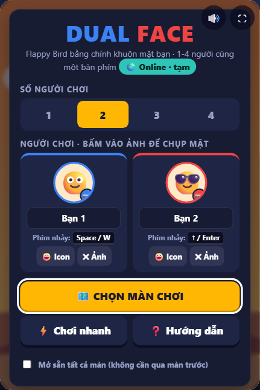
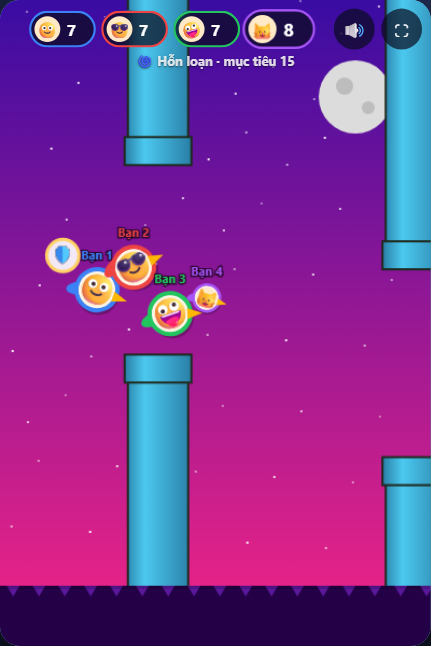
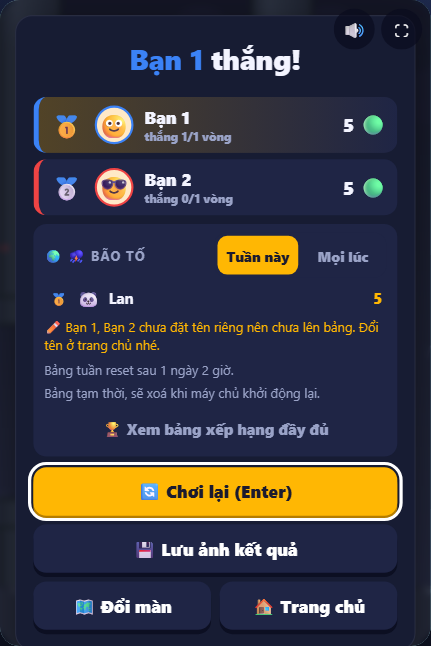
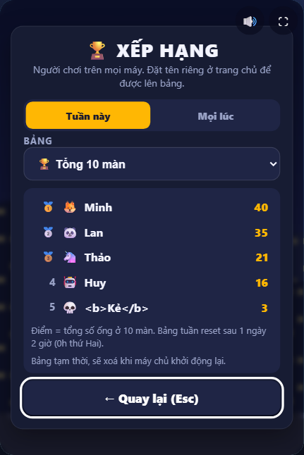

# Dual Face 🐥

**Flappy Bird bằng chính khuôn mặt bạn.** 1-4 người cùng một bàn phím, 10 màn chơi, vật phẩm phá nhau, giải đấu và bảng xếp hạng online.

*Flappy Bird where the bird is your own face (webcam). Up to 4 players on one keyboard, 10 levels, power-ups, tournament mode and an online leaderboard. Plain JS, no build step.*

[](https://dualface.onrender.com/)
[](https://github.com/thanhtq2701-alt/dualface/actions/workflows/ci.yml)


[](LICENSE)

| Trang chủ | 4 người cùng chơi | Kết quả | Bảng xếp hạng |
|:---:|:---:|:---:|:---:|
|  |  |  |  |

> Bản tĩnh không có bảng xếp hạng online: [thanhtq2701-alt.github.io/dualface](https://thanhtq2701-alt.github.io/dualface/)

## Cách chơi

1. Chọn số người, mỗi người **bấm vào ảnh để chụp mặt** bằng webcam (hoặc chọn emoji).
2. Chọn màn. Đạt đủ số ống mục tiêu để mở màn kế tiếp.
3. Mỗi người một phím nhảy. Ai bay lâu nhất thắng vòng.

| Người | Phím nhảy | Tay cầm | Điện thoại |
|---|---|---|---|
| 🔵 P1 | `Space` / `W` | tay cầm 1, nút A | chạm cột 1 |
| 🔴 P2 | `↑` / `Enter` | tay cầm 2, nút A | chạm cột 2 |
| 🟢 P3 | `I` / `P` | tay cầm 3, nút A | chạm cột 3 |
| 🟣 P4 | `X` / `Numpad 0` | tay cầm 4, nút A | chạm cột 4 |

`Esc` hoặc `P` để tạm dừng.

### Chế độ & vật phẩm

- **Vòng đơn**: chơi một màn, mở khoá dần như các game nhiều màn trên 234player.
- **Giải đấu**: chơi lần lượt 10 màn, cộng điểm theo hạng mỗi vòng, cuối giải có nhà vô địch.
- **Vật phẩm** (từ màn 2): 🛡️ khiên đỡ một lần · 🪶 bay nhẹ · 🍄 thu nhỏ bản thân · 🎈 làm đối thủ phình to.
- **Lưu ảnh kết quả**: ảnh PNG có mặt người thắng đội vương miện, để khoe.
- **Bảng xếp hạng online**, không cần tài khoản, đặt tên riêng là được lên bảng:
  - **Tuần này**: reset 0h thứ Hai giờ Việt Nam, người mới luôn có cơ hội lên top.
  - **Mọi lúc**: kỷ lục giữ mãi.
  - **Tổng 10 màn**: cộng kỷ lục của bạn ở cả 10 màn để tìm người giỏi nhất.

### 10 màn

| # | Màn | Cơ chế | Độ khó |
|---|---|---|---|
| 1 | 🌱 Đồng cỏ | Làm quen, khe rộng | ★☆☆☆☆ |
| 2 | 🌇 Hoàng hôn | Nhanh dần, khe hẹp dần, bắt đầu có vật phẩm | ★★☆☆☆ |
| 3 | 🌃 Thành phố đêm | Khe trượt lên xuống | ★★★☆☆ |
| 4 | 🪨 Hang động | Nhũ đá sát nhau, dơi bay qua khe | ★★★☆☆ |
| 5 | 🌬️ Gió lốc | Gió thổi lên/xuống, có cảnh báo | ★★★★☆ |
| 6 | 🧊 Băng giá | Nhũ băng rơi khi bạn tới gần | ★★★★☆ |
| 7 | 🌙 Mặt trăng | Trọng lực thấp, thiên thạch | ★★★★☆ |
| 8 | 🌋 Núi lửa | Cầu lửa phun từ đất, có dấu báo | ★★★★★ |
| 9 | ⛈️ Bão tố | Sét chớp che ống, gió mạnh | ★★★★★ |
| 10 | 🌀 Hỗn loạn | Đảo trọng lực mỗi 5 ống | ★★★★★ |

## Quyền riêng tư

- Ảnh mặt **chỉ lưu trong trình duyệt của bạn**, không bao giờ gửi lên máy chủ.
- Bảng xếp hạng chỉ nhận tên, emoji và số ống.
- Mỗi trình duyệt có một mã ngẫu nhiên để kỷ lục của bạn không bị người trùng tên ghi đè. Mã này không hiện cho ai.

## Chạy trên máy

Cần Node 22 trở lên. Không cần `npm install`.

```bash
npm start            # game + API bảng xếp hạng: http://localhost:8080
npm test             # 40 test: vật lý, từng màn với bot, vật phẩm, API, bảng tuần/tổng, Redis giả
npm run shot         # (sau npm start) chụp các màn bằng Chrome headless, báo lỗi console
```

Tham số URL để thử nhanh: `?screen=levels`, `?screen=board&board=total&period=week`, `?level=city&bots=1&players=3`, `?bots=1&players=3&tour=volcano`.

## Deploy

**Render** (đang dùng): Dashboard → New → **Blueprint** → chọn repo này. Render đọc [`render.yaml`](render.yaml) và chạy `node server/index.js`. Kiểm tra tại `/api/health`.

Mặc định bảng xếp hạng lưu trong bộ nhớ: mất khi server ngủ (15 phút không ai chơi) hoặc deploy lại, và game ghi rõ "tạm" cho người chơi. Muốn giữ lâu dài, thêm hai biến `UPSTASH_REDIS_REST_URL` và `UPSTASH_REDIS_REST_TOKEN` trong tab Environment của service. Có thể dùng chung một database Upstash với dự án khác vì Dual Face chỉ dùng khoá `df:v2:*`.

**GitHub Pages** tự deploy bản tĩnh từ nhánh `main`. Game tự ẩn phần online khi không có máy chủ.

### API

| Method | Đường dẫn | Mô tả |
|---|---|---|
| GET | `/api/health` | `{ok, store}`, `store` là `upstash` hoặc `memory` |
| GET | `/api/scores?board=<màn\|total>&period=<all\|week>&pid=<mã máy>` | top 10; dòng của máy này có `me: true`; kèm `week`, `resetsAt` |
| GET | `/api/bests?pid=<mã máy>` | kỷ lục mọi lúc cao nhất từng màn |
| POST | `/api/scores` | `{level, pid, name, score, emoji}`, ghi khi cao hơn kỷ lục cũ (mọi lúc và tuần), trả `top` + `topWeek` |
| POST | `/api/stats` | `{level, players, deaths:[{at, reason}]}`, ghi một lượt chơi và kết quả từng người; không gửi pid, tên hoặc ảnh |
| GET | `/api/stats` | `{stats: {<màn>: {plays, reasons, pipes}}}`; thống kê tổng hợp của 10 màn |

`reason` là `pipe`, `ground`, `ceiling`, `icicle`, `fire`, `hazard` hoặc `alive`; `at` là số ống đã qua khi chết (người sống dùng điểm hiện tại). Index 30 trở lên được gộp thành bucket `30+`. Thống kê gồm cả vòng có bot. Tên bảng xếp hạng tối đa 10 ký tự, tên mặc định như "Bạn 1" bị từ chối. Giới hạn 60 yêu cầu mỗi phút mỗi IP.

## Cấu trúc

```
index.html            điểm vào duy nhất
web/css/style.css     giao diện
web/js/core/          util, physics, audio, input (phím/chạm/tay cầm), storage, camera, api
web/js/engine/        flappy.js: engine dùng chung cho mọi màn (ống, vật phẩm, cơ chế, vẽ, bot)
web/js/levels.js      cấu hình 10 màn
web/js/app.js         màn hình, vòng lặp 60Hz, HUD, giải đấu, ảnh kết quả, bảng online
server/               index.js (tĩnh + API, Node thuần), store.js (Upstash REST hoặc bộ nhớ)
tests/                node --test
tools/                serve.js (server tĩnh), screenshot.js (Chrome headless qua DevTools Protocol)
docs/                 PROJECT.md (kiến trúc, cách thêm màn, lộ trình), PLAYTEST.md, images/
old/                  bản v1 một file
render.yaml           Render Blueprint
```

Thêm một màn = thêm một object vào [`web/js/levels.js`](web/js/levels.js). Chi tiết trong [docs/PROJECT.md](docs/PROJECT.md).

## Lộ trình

- Màn Boss: ống khổng lồ đuổi theo. Màn Gương: bay từ phải sang trái.
- Chế độ đồng đội 2v2.
- Đổi phím nhảy cho từng người.
- Lịch sử trận đấu và biểu đồ tiến bộ.
- Thách đấu qua link, cài lên điện thoại như app, đếm lượt chơi từng màn.
- Tiếng Anh.

## Giấy phép

[Apache-2.0](LICENSE)
